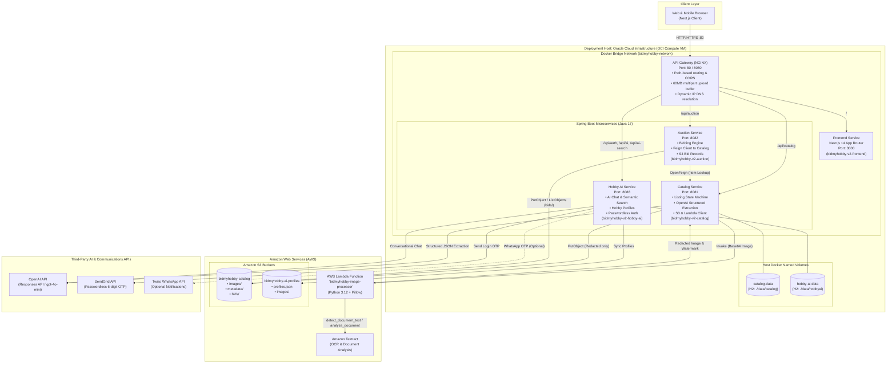

# BidMyHobby System Architecture

## 1. System Overview

**BidMyHobby** is an AI-assisted hobby marketplace platform featuring conversational listing creation, auction workflows, hobbyist social discovery, and privacy-first media processing.

The repository is organized as a polyglot monorepo containing:
- **Web Frontend**: Next.js 14 (App Router)
- **API Gateway**: NGINX (Reverse proxy, CORS, multipart buffer)
- **Microservices**: Java 17 Spring Boot (Catalog, Auction, Hobby-AI)
- **Serverless**: Python 3.12 AWS Lambda (Amazon Textract OCR, pixel redaction, watermarking)
- **Target Deployment Platform**: Oracle Cloud Infrastructure (OCI) Linux Compute VM & Amazon Web Services (AWS)

---

## 2. Architecture Diagram



---

## 3. Component Breakdown & Responsibilities

| Component | Path | Technology | Responsibilities |
| :--- | :--- | :--- | :--- |
| **Frontend** | `apps/web` | Next.js 14, React, TypeScript | Marketplace catalog browsing, interactive conversational listing wizard, draft review & confirmation, bidding interface, profile chat, and cookie-based auth session management. |
| **API Gateway** | `services/api-gateway` | NGINX (Alpine) | Single entry point. Enforces CORS headers, handles 60MB multipart uploads for multi-photo submissions, proxies to microservices by path, and dynamically re-resolves internal container DNS every 10 seconds. |
| **Catalog Service** | `services/catalog` | Spring Boot 3, Java 17 | Manages listing drafts, conversational state machine, multimodal OpenAI structured prompting, invokes the AWS Lambda image processor, and commits finalized listings and media to Amazon S3. |
| **Auction Service** | `services/auction` | Spring Boot 3, Java 17 | Manages bid placement and listing status updates. Persists bid transactions directly into S3 as partitioned JSON files (`bids/{itemId}/{bidId}.json`). Queries Catalog Service via OpenFeign. |
| **Hobby-AI Service** | `services/hobby-ai` | Spring Boot 3, Java 17 | Manages hobbyist profiles, conversational AI matching, semantic search, and passwordless authentication. Generates 6-digit OTPs via SendGrid (and optional Twilio WhatsApp) and issues HS256 signed JWTs. |
| **Image Processor Lambda** | `lambdas/image-processor` | Python 3.12, Pillow, Boto3 | Serverless OCR and privacy processor. Detects phone numbers/emails via Amazon Textract, applies pixel-level blackouts, adds masked-owner watermarks, and parses business cards. |

---

## 4. Deployment Platforms & Topology

### 4.1 Oracle Cloud Infrastructure (OCI) Production Host

The production backend runs on an OCI compute instance (Linux `amd64`) orchestrated with Docker Compose:

- **Compose Configuration**: `docker-compose.oci.yml`
- **Container Network**: Isolated bridge network (`bidmyhobby-network`).
- **Prebuilt Image Pipeline**: `scripts/build-oci-images.sh` packages images using `docker buildx` for `linux/amd64` into a single deployable `.tar.gz` bundle:
  - `bidmyhobby-v2-frontend:latest`
  - `bidmyhobby-v2-catalog-service:latest`
  - `bidmyhobby-v2-auction-service:latest`
  - `bidmyhobby-v2-hobby-ai-service:latest`
  - `nginx:alpine`
- **JVM Startup Optimizations**: To run reliably on resource-constrained OCI shapes (such as 1 GB RAM instances), JVM services run with `-XX:TieredStopAtLevel=1` to reduce JIT warmup overhead.
- **Actuator Health Checks**: Automated container startup checks with extended grace periods (`start_period: 360s`) to ensure container readiness before the NGINX gateway starts routing traffic.

### 4.2 Local Development Environment

- **Compose Configuration**: `docker-compose.local.yml`
- **Workflow**: Builds services directly from source Dockerfiles (`Dockerfile.local` / `Dockerfile`).
- **Ports**: Gateway exposed on `8080`, frontend directly accessible at `3000`, Catalog at `8081`, Auction at `8082`, and Hobby-AI at `8088`.

---

## 5. Serverless Image Processing & Fail-Closed Privacy Boundary

To protect seller privacy when uploading hobby photos or business cards, BidMyHobby utilizes a serverless redaction pipeline backed by **AWS Lambda** and **Amazon Textract**:

```
[User Uploads Image]
         │
         ▼
[Catalog Service] ──(AWS SDK InvokeRequest)──► [AWS Lambda: bidmyhobby-image-processor]
                                                         │
                                                         ├──► [Amazon Textract]
                                                         │    (detect_document_text & analyze_document)
                                                         │
                                                         ├──► [Pillow (PIL)]
                                                         │    (Pixel-level blackout of phone/email)
                                                         │
                                                         └──► [Pillow (PIL)]
                                                              (Masked watermark: "BidMyHobby | ******1234")
                                                                 │
[Catalog Service] ◄────────(Return Redacted JPEG)────────────────┘
         │
         ▼
[Amazon S3 Storage] (Only redacted images are ever saved to public/permanent storage)
```

### Safety Guarantees:
- **Pixel-Level Redaction**: Rather than relying on metadata removal, matching OCR lines containing phone numbers or email addresses are permanently drawn over with solid rectangles.
- **Fail-Closed Boundary**: If Textract OCR or redaction fails, the Lambda returns a non-200 status code. The Catalog Service immediately aborts the publishing process. The system **never** silently falls back to publishing unredacted original images.

---

## 6. Data Storage & Persistence

1. **Local Persistent Volumes (Embedded H2)**:
   - `catalog-data:/app/data`: File-backed H2 database storing conversational listing transcripts, draft fields, versions, and intermediate state machines.
   - `hobby-ai-data:/app/data`: File-backed H2 database storing user profiles, hobbies, and session data.
2. **Amazon S3 Object Storage**:
   - `bidmyhobby-catalog`:
     - `images/`: Publicly viewable, processed, watermarked listing images.
     - `metadata/`: Structured JSON catalog items.
     - `bids/`: Partitioned bid records (`bids/{itemId}/{bidId}.json`).
   - `bidmyhobby-ai-profiles`:
     - `profiles.json`: Baseline hobbyist profile repository.
     - `images/`: Profile avatar images.

---

## 7. Authentication & Security Model

- **Passwordless Authentication**: Users log in via email by receiving a 6-digit verification code sent through **SendGrid** (handled by `services/hobby-ai`).
- **Stateless HS256 JWT**: Verification produces an HMAC-SHA256 token signed with `AUTH_TOKEN_SECRET` (minimum 32 characters).
- **Secure Cookies**: Stored in the browser via an `HttpOnly`, `Secure`, `SameSite=Strict` cookie.
- **Decentralized Verification**: Each backend service (`catalog`, `auction`, `hobby-ai`) has an independent `AuthenticatedUser` filter that verifies the JWT locally using the shared `AUTH_TOKEN_SECRET`. No cross-service auth calls are needed.
